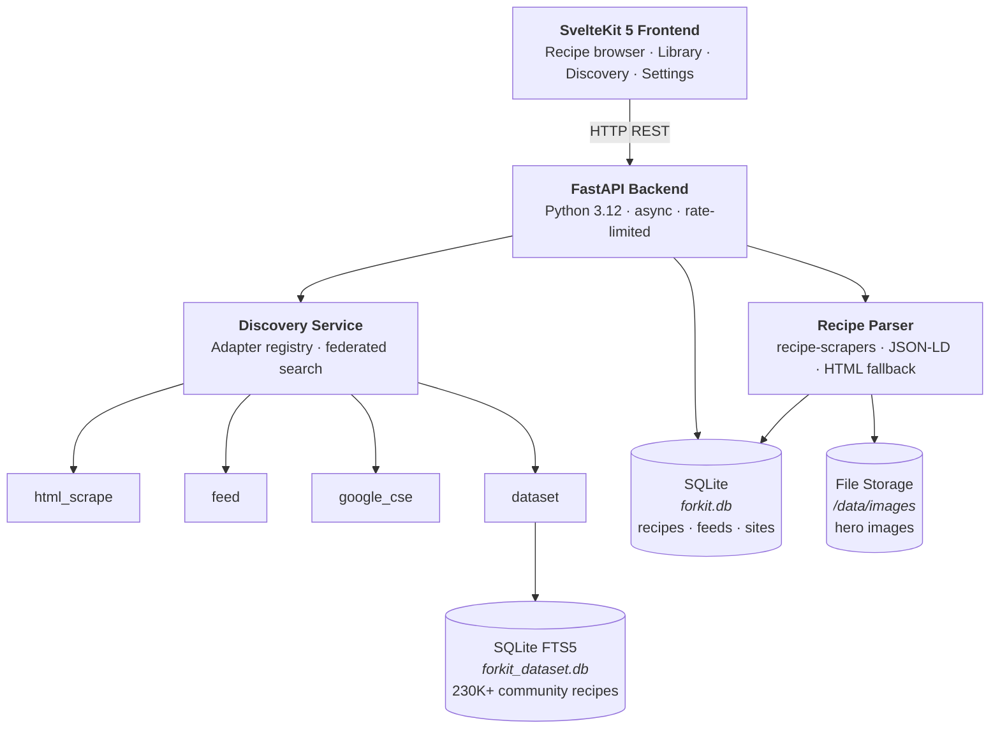
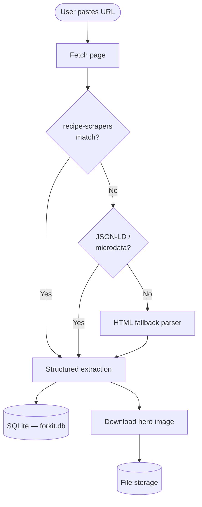
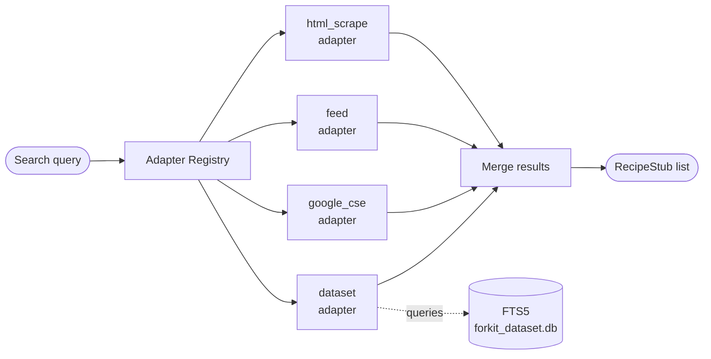

# Forkit

**Your personal, self-hosted recipe collection.**

Forkit is a self-hosted recipe accumulator that lets you collect recipes from anywhere on the web and discover new ones from hundreds of recipe sites — all from a single, local-first interface. Paste any recipe URL, Forkit extracts clean, structured recipe data and stores it in your personal library. Search, filter, tag, and build your own cookbook.


## Features

- **Parse any recipe URL** — Paste any recipe link; Forkit extracts title, ingredients, instructions, timing, and images automatically
- **Personal recipe library** — Save recipes, add notes, rate them, track cook history, and organize with tags and cuisine filters
- **Multi-site discovery** — Search recipes across popular sites (Epicurious, AllRecipes, etc.) and RSS feeds without signing up or sharing data
- **Community recipe dataset** — Access ~230K recipes from Food.com (CC-BY-SA 3.0) locally, indexed for full-text search — no API keys required
- **Self-hosted, privacy-first** — Your data never leaves your machine. Run locally on Docker or on your own server
- **RSS feed subscriptions** — Subscribe to recipe site feeds and get notified of new recipes from your favorite authors
- **Site discovery wizard** — Add new recipe sites by pasting any URL; Forkit auto-detects feeds and search patterns
- **Docker-based deployment** — Single-command deployment with persistent data volumes

## Architecture



### Recipe Ingestion Flow



### Discovery Flow



### Frontend (SvelteKit)
A static single-page app built with Svelte 5 runes. No server-side rendering. Communicates with the backend via REST API. Features recipe search, library management, and discovery interface. Service worker support for offline-ready PWA behavior.

### Backend (FastAPI)
Python 3.12 async API server. Routes all user requests and discovery queries to the appropriate service. Enforces rate limiting (10 req/min for most endpoints, 5 req/min for heavy operations like site testing). Structured logging with request context for debugging.

### Database Layer
Two SQLite databases:
- **Main DB** (`forkit.db`): Recipes, ingredients, tags, cook history, discovery sites, subscribed feeds, and search caches
- **Dataset DB** (`forkit_dataset.db`): Food.com recipe corpus (~230K recipes) indexed with SQLite FTS5 for full-text search. Imported on-demand via CLI.

### Discovery Service
Abstracts multiple recipe sources behind a unified interface. Four adapter types:
- **html_scrape**: Extracts recipes from a single URL using recipe-scrapers
- **feed**: Polls RSS feeds for new recipe links
- **google_cse**: Custom Google Search Engine for broad site coverage
- **dataset**: Full-text search across local Food.com corpus

## Quick Start

### Prerequisites
- Docker + Docker Compose
- (Optional) Python 3.12+ and `uv` for local development

### Docker (Recommended)

Clone the repository and start the stack:

```bash
git clone https://github.com/10Legs/forkit.git
cd forkit
docker compose up -d
```

Open your browser to `http://localhost:8080` (or the port configured in your environment).

### Local Development

Backend dev server (auto-reload):

```bash
cd backend
uvicorn forkit.main:app --reload --host 0.0.0.0 --port 8001
```

Frontend dev server:

```bash
cd frontend
npm run dev
# Opens http://localhost:5173
```

Run tests:

```bash
make test
```

## Using Forkit

### Ingesting Recipes

1. Find a recipe online
2. Copy the recipe URL
3. Click **Add Recipe** and paste the URL
4. Forkit extracts the recipe and shows a preview
5. Click **Save** to add it to your library

Forkit uses `recipe-scrapers` (supports 100+ sites) and falls back to structured data extraction (JSON-LD, microdata) and HTML parsing if needed.

### Searching Your Library

- **Browse**: Scroll all recipes, sorted by date added
- **Search**: Full-text search across titles, descriptions, and ingredients
- **Filter**: By cuisine, meal type, cook time, or custom tags
- **Tags**: Create custom tags to organize recipes your way
- **History**: Track which recipes you've cooked and when

### Discovery: Search Across Sites

Use **Discovery** to search recipes without saving them first:

1. Click **Discover** in the main menu
2. Enter a search query (e.g., "vegan pasta")
3. Forkit searches configured sites and returns results in real-time
4. Click a result to view the full recipe on its original site
5. Click **Save to Library** to add it to your personal collection

By default, Forkit searches:
- Epicurious, AllRecipes, Food Network, Serious Eats (via HTML scraper)
- Food.com dataset (~230K recipes, local, fast)
- Popular food blogs (via RSS feeds)

### Adding Custom Discovery Sites

Settings → **Discovery** → **Add Site**

Choose how Forkit should search the site:
- **HTML Scraper**: Point to the site's recipe page template (e.g., `epicurious.com/recipes/`)
- **RSS Feed**: Paste the feed URL (e.g., `seriouseats.com/feed`)
- **Google CSE**: Configure a custom search engine (requires Google CSE ID and key)
- **Detect Automatically**: Paste any URL and Forkit will detect available feeds and search patterns

## Importing the Community Recipe Dataset

Forkit ships with built-in discovery sites, but you can optionally import the Food.com dataset for local, full-text search across 230K+ recipes.

### Prerequisites

Download the dataset from Kaggle:
1. Go to https://www.kaggle.com/datasets/shuyangli94/food-com-recipes-and-user-interactions
2. Sign in and download `RAW_recipes.csv`
3. Save to a local path (e.g., `/tmp/RAW_recipes.csv`)

### Import

If using Docker:

```bash
docker compose exec web forkit dataset import foodcom \
  --data-path /tmp/RAW_recipes.csv \
  --accept-license
```

If running locally:

```bash
forkit dataset import foodcom \
  --data-path /tmp/RAW_recipes.csv \
  --accept-license
```

The importer will:
- Read the CSV (~530MB)
- Parse and normalize ~230K recipes
- Create SQLite FTS5 full-text index
- Save to `forkit_dataset.db` (~1.5GB on disk)

Check import progress:

```bash
docker compose exec web forkit dataset stats
```

**Note**: Dataset is CC-BY-SA 3.0. You must accept the license to import.

## Configuration

Set environment variables in `docker-compose.yml` or `.env`:

| Variable | Default | Description |
|----------|---------|-------------|
| `PORT` | `8080` | Port to expose the app (maps to backend 8000) |
| `FORKIT_DB_PATH` | `/data/forkit.db` | Path to main SQLite database |
| `FORKIT_IMAGE_DIR` | `/data/images` | Path to store downloaded recipe images |
| `FORKIT_CACHE_DIR` | `/data/cache` | Path to cache directory (includes dataset DB) |
| `FORKIT_LOG_LEVEL` | `info` | Logging level: `debug`, `info`, `warning`, `error` |
| `FORKIT_AUTH_MODE` | `none` | Auth strategy: `none` or `acknowledge_wan_exposed` (security) |
| `HERMITHOST_PORT_MODE` | `lan` | HermitHost integration: `lan` or other (security gate) |

For WAN exposure, set auth mode:

```bash
docker compose up -e FORKIT_AUTH_MODE=acknowledge_wan_exposed -d
```

## Tech Stack

| Layer | Technology | Notes |
|-------|-----------|-------|
| Frontend | SvelteKit 5, Svelte 5 (runes) | Static SPA, client-side routing |
| Backend | FastAPI 0.115+, Python 3.12 | Async REST API, structured logging |
| Database | SQLite 3 + FTS5 | Main DB + dataset index, no server needed |
| ORM | SQLAlchemy 2.0 | Async sessions, migrations via Alembic |
| Recipe Parsing | recipe-scrapers 15+, BeautifulSoup, extruct | Covers 100+ recipe sites + fallbacks |
| Feed Parsing | feedparser 6.0, defusedxml | Safe RSS/Atom feed parsing |
| HTTP Client | httpx 0.27 | Async, rate-limited via slowapi |
| Structured Logging | structlog | JSON logs with request context |
| Rate Limiting | slowapi | Per-IP limits (10 req/min default) |
| Containerization | Docker Compose | Single-file deployment |

## API Reference

### Core Endpoints

#### GET /api/recipes
List all recipes in the personal library.

Query parameters:
- `skip` (int): Pagination offset (default 0)
- `limit` (int): Page size (default 20)
- `search` (str): Full-text search query
- `cuisine` (str): Filter by cuisine
- `tag` (str): Filter by tag ID

Response: `{ recipes: Recipe[], total: int }`

#### GET /api/recipes/{id}
Get full recipe details.

Response: `Recipe` object with all fields.

#### POST /api/ingest
Add a recipe from a URL.

Request body:
```json
{
  "url": "https://example.com/recipe/chocolate-cake"
}
```

Response:
```json
{
  "id": "uuid",
  "title": "Chocolate Cake",
  "state": "ingested",
  "hero_image_path": "/images/uuid.jpg"
}
```

Rate limited to **10 requests per minute** per IP.

#### GET /api/search/discovery
Search recipes across configured discovery sites.

Query parameters:
- `q` (str): Search query (required)
- `timeout_sec` (int): Timeout per site (default 10)

Response: `{ results: RecipeStub[], errors: { site_name: error_msg } }`

#### GET /api/sites
List all configured discovery sites.

Response: `{ sites: DiscoverySite[] }`

Sensitive fields (API keys, tokens) are redacted.

#### POST /api/sites/{id}/test
Test a discovery site configuration.

Response: Sample results or error details.

Rate limited to **5 requests per minute** per IP.

#### GET /api/feed/items
List recently polled feed items.

Response: `{ items: FeedItem[] }`

#### POST /api/feed/poll
Manually poll all subscribed feeds.

Response: `{ polled_count: int, new_items: int }`

Rate limited to **5 requests per minute** per IP.

### Health Check

#### GET /healthz
Service health check.

Response:
```json
{
  "status": "ok",
  "version": "0.1.0",
  "db_ok": true
}
```

## Development

### Project Structure

```
forkit/
├── backend/
│   ├── src/forkit/
│   │   ├── main.py              — FastAPI app entry point
│   │   ├── api/                 — HTTP endpoints
│   │   ├── parser/              — Recipe URL parsing & fetching
│   │   ├── discovery/           — Multi-source search
│   │   ├── dataset/             — Food.com dataset import & search
│   │   ├── models/              — SQLAlchemy ORM models
│   │   ├── db.py                — SQLAlchemy session management
│   │   ├── config.py            — Settings from environment
│   │   └── cli.py               — forkit CLI (dataset import)
│   ├── pyproject.toml           — Dependencies & metadata
│   ├── Dockerfile               — Container build
│   └── tests/                   — Pytest test suite
├── frontend/
│   ├── src/routes/              — SvelteKit page components
│   ├── src/lib/                 — Reusable components & utilities
│   ├── svelte.config.js         — SvelteKit config (SPA mode)
│   ├── package.json             — Dependencies
│   └── vite.config.js           — Vite config
├── docker-compose.yml           — Multi-service deployment
├── Makefile                     — Common commands
└── README.md                    — This file
```

### Running Tests

```bash
make test
```

Runs pytest (backend) and npm test (frontend).

### Linting & Type Checking

Backend (Python):

```bash
cd backend
ruff check .
mypy .
```

Frontend (JavaScript/TypeScript):

```bash
cd frontend
npm run lint
```

### Building for Production

```bash
make build
```

Creates an optimized Docker image. Builds frontend inside the container.

### Database Migrations

Forkit uses Alembic for schema migrations.

Create a new migration:

```bash
docker compose exec web alembic revision --autogenerate -m "description"
```

Apply pending migrations:

```bash
make migrate
```

## Troubleshooting

### App won't start / "refuses to start"

**Symptom**: Container logs show `forkit refuses to start: HERMITHOST_PORT_MODE is not 'lan'`

**Solution**: If exposing Forkit on the WAN (not localhost), set:

```bash
docker compose up -e FORKIT_AUTH_MODE=acknowledge_wan_exposed -d
```

This is a security guard to prevent accidental public exposure without auth.

### Recipe parsing fails for a specific URL

**Symptom**: "Failed to extract recipe" error

**Possible causes**:
- Site blocks automated requests (requires authentication or User-Agent handling)
- Recipe is behind a paywall or JavaScript-rendered
- Site uses a novel recipe format not covered by recipe-scrapers

**Solutions**:
1. Try parsing with a different recipe site if available
2. File an issue with the recipe URL; we can add site-specific handling
3. For JavaScript-heavy sites, consider adding site to custom discovery with RSS feed if available

### Discovery search hangs or times out

**Symptom**: Discovery search returns `{ errors: { site_name: "timeout" } }`

**Cause**: A discovery site is slow to respond or unreachable

**Solutions**:
- Increase `timeout_sec` parameter (API default is 10s)
- Disable the slow site in Settings → Discovery
- Check your network connection

### Dataset import fails

**Symptom**: `forkit dataset import` command fails with parsing errors

**Possible causes**:
- CSV file is corrupted or incomplete
- Path to CSV is incorrect
- Insufficient disk space for index (~1.5GB)

**Solutions**:
1. Re-download `RAW_recipes.csv` from Kaggle
2. Check disk space: `df -h /data`
3. Check logs: `docker compose logs web`

### Images not displaying

**Symptom**: Recipe cards show broken image icons

**Cause**: Image download failed during ingestion, or image directory not mounted

**Solutions**:
1. Check volume mount in docker-compose.yml: `forkit-data:/data`
2. Verify image directory exists: `docker compose exec web ls -la /data/images`
3. Re-ingest the recipe to retry image download

## Contributing

Contributions are welcome! Whether it's a bug fix, new discovery site adapter, or UX improvement, please open an issue or pull request.

- **Issues**: Report bugs, request features, ask questions
- **PRs**: Submit code changes with tests and documentation
- **Discussions**: Architecture questions, site recommendations, feature ideas

## License

Forkit is provided as-is. See the LICENSE file for details.

Recipe data from Food.com is CC-BY-SA 3.0. Respect those terms when using the dataset.
